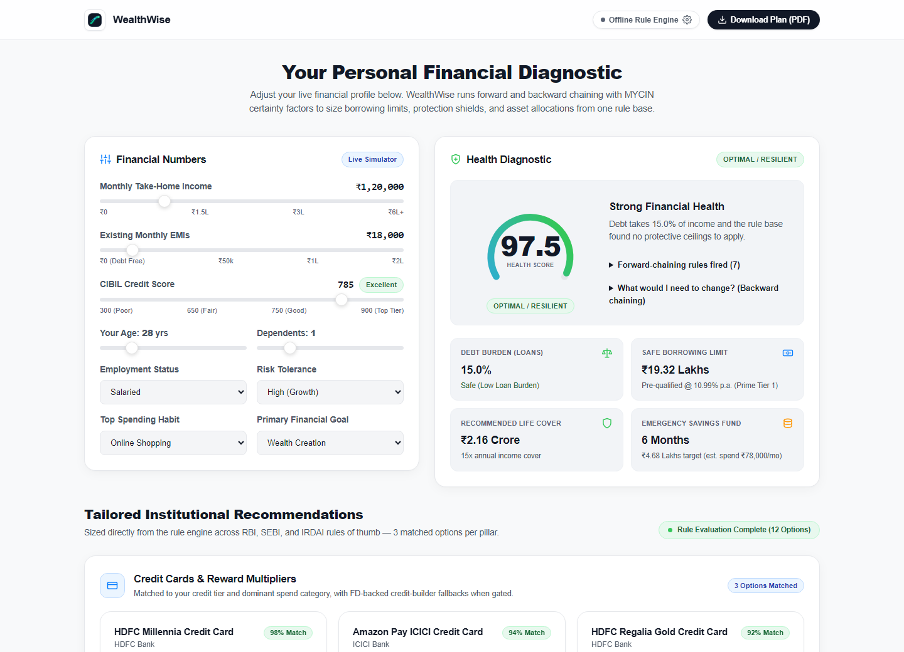

# WealthWise

An explainable expert system for personal finance. It runs forward chaining over a rule base to size loans, life and health cover, investments and credit cards, scores overall financial health from 0 to 100, and answers "what would I need to change?" with verified backward chaining. Every recommendation can be traced to the rules that produced it.

[](https://github.com/SeeThisDiva/wealthwise-ai/actions/workflows/tests.yml)
[](LICENSE)
[](pyproject.toml)

By [SeeThisDiva](https://github.com/SeeThisDiva). An educational project, not financial advice.



## What it does

- **Forward chaining.** A match-resolve-act loop over 17 production rules in four modules (loans 5, insurance 6, investments 2, credit cards 4), with salience-based conflict resolution and a working memory of asserted and retracted facts.
- **Backward chaining.** Pick a goal such as `loan.eligible`, `credit.eligible`, `insurance.term_recommended`, or `investment.risk_category` in the web dashboard or CLI. The engine finds the rules blocking it, asks each rule for its remedy, and then re-runs forward chaining to **verify** that the combined plan really achieves the goal. Blockers the client cannot change (such as age) are reported as such.
- **Certainty factors.** MYCIN-style certainty factors in `[-1, 1]` with the classic combination function. A rule that builds on another inferred fact inherits that fact's uncertainty, and each firing records its `premise_cf`.
- **Financial Health Index.** A weighted score (solvency 0.30, coverage 0.25, liquidity 0.25, credit 0.20) with protective ceilings that high income cannot hide: FOIR above 55% caps the score at 45, CIBIL below 620 caps it at 40, dependents with no life cover cap it at 55, and non-earning status caps it at 35.
- **One source of truth.** The dashboard vitals, offline product cards, REST API, CLI and PDF all read the same `analyze()` result and `core.vitals` builder. The browser does no scoring maths; if the server is unreachable it shows dashes.
- **Stress test.** Apply a rate hike and an income drop and see the resulting debt ratio and leftover monthly cash flow.
- **PDF plan.** A two-page plan with the client snapshot, rule-sized vitals, stress check, four-pillar action list and a SHA-256 fingerprint of the profile and results.
- **Optional Gemini advisor.** With a Google Gemini API key, product recommendations are generated by the model and validated against strict schema and link-host allowlists. Without one, the deterministic offline rule-engine advisor runs locally with zero network calls.

Example (CLI):

```cmd
python main_cli.py --name "Test Client" --income 38000 --credit-score 595 --emis 23500 --seek-goal "loan.eligible"
```

returns: raise the score by 55 points to 650 and cut EMIs by at least ₹5,001 a month (to ₹18,499), and confirms that with those changes the loan rules approve.

## Quick start

```cmd
pip install -r requirements.txt
python main.py
```

The server starts on http://127.0.0.1:5000 and opens your browser. For the terminal version:

```cmd
python main_cli.py --name "Test Client" --income 135000 --credit-score 795 --pdf plan.pdf
```

| Variable | Default | Purpose |
| :--- | :--- | :--- |
| `GEMINI_API_KEY` | unset | Enables the Gemini advisor. Put it in a `.env` file (copy `.env.example`) or paste it into the in-app dialog. |
| `GEMINI_MODELS` | `gemini-2.5-flash,gemini-flash-latest` | Comma-separated Gemini models to try, in order. |
| `WEALTHWISE_HOST` | `127.0.0.1` | Address to listen on. Anything other than loopback is refused unless `WEALTHWISE_ALLOW_REMOTE=1`. |
| `WEALTHWISE_PORT` | `5000` | Port to listen on (`1`–`65535`). |
| `WEALTHWISE_ALLOW_REMOTE` | unset | Set to `1` to allow a non-loopback `WEALTHWISE_HOST` (when bound to `0.0.0.0` or `::`, the active LAN IP is permitted automatically). The app has no login, so use this only on a trusted network. |
| `WEALTHWISE_ALLOWED_HOSTS` | unset | Optional comma-separated list of additional `Host` header names permitted when remote access is enabled. |

## Privacy and security

**Data & zero-CDN frontend.** Everything runs locally on your machine with self-hosted inline SVG icons—opening the dashboard makes zero outbound third-party font or CDN requests. The one optional network call is Google Gemini: when a key is set, your bounded numeric and allowlisted categorical attributes (income, EMIs, credit score, age, employment, dependents, risk tolerance, goal and spend category) are sent to Google to generate product text. Your name is never sent. Leave the key unset to keep all data 100% local. A key pasted into the dialog is held in the tab's session storage, sent to the local server in `X-Gemini-Api-Key`, never written to disk, and never logged.

**Hardening.**

- **Loopback only by default.** The server answers only requests addressed to an allowlisted `Host` header (blocks DNS rebinding), rejects `Sec-Fetch-Site: cross-site` requests, keeps `GET` routes side-effect-free, and requires a per-launch `X-CSRF-Token` plus matching `Origin` on every `POST`.
- **Strict input schemas.** Inputs are validated with Pydantic (`extra="forbid"`, boolean-as-number rejection, finite numeric ranges, and allowlisted categories). The Gemini endpoint clamps numbers and allowlists categories so no free text reaches the prompt.
- **Untrusted model & PDF output encoding.** Model output is rebuilt field by field, text is length-limited, and each `apply_url` must be `https://` on a hostname already present in the built-in catalogue. Anything else is replaced from the offline advisor. The browser escapes all text, refuses non-`https` links, and ReportLab XML-escapes every dynamic field with neutral PDF metadata.
- **Headers & limits.** Strict CSP (`default-src 'self'`, `script-src 'self'`, `font-src 'self'`, `connect-src 'self'`, no inline scripts, no `eval`, `object-src 'none'`, `frame-ancestors 'none'`), no stack traces or internal details in error responses, 32 KB request body limit, thread-safe sliding-window rate limiting, and `Cache-Control: no-store` on API responses.

**Honest limits.** The SHA-256 value in the PDF and audit record is an integrity fingerprint, not a cryptographic signature: anyone can recompute it, so it detects accidental changes rather than proving authorship. The built-in Flask server is meant for local use, not the open internet.

See [SECURITY.md](SECURITY.md) to report a vulnerability privately.

## Project layout

```
.github/workflows/  GitHub Actions CI (ruff lint + Ubuntu/Windows pytest matrix)
assets/             dashboard screenshot
core/               engine, facts, rules, uncertainty (CF), scoring, vitals, security, gemini_advisor
knowledge/          rule bases: loan, insurance, investment, credit cards
data/               static product catalogue
reports/            ReportLab PDF generator
web/                Flask server, templates, self-hosted static assets
advisor.py          orchestrates all rule bases (one private engine per request)
main.py             web entry point
main_cli.py         terminal entry point
pyproject.toml      package metadata, console scripts, pytest & ruff configuration
tests/              unit, concurrency, math-parity, and HTTP security tests
```

## Development & tests

```cmd
pip install -e ".[dev]"
ruff check .
pytest --cov=core --cov=knowledge --cov=reports --cov=web --cov=advisor --cov-report=term-missing
```

The suite needs no network and no API key. It covers working memory, certainty-factor maths and attenuation, forward chaining and salience, verified backward chaining (including a grid check against forward chaining), scoring ceilings, single-source-of-truth parity across dashboard/advisory/PDF, mass-assignment and boolean rejection, PDF XML escaping and SHA-256 fingerprinting, request filtering (`Host`, CSRF, `Origin`, `Sec-Fetch-Site`), Gemini prompt/output isolation, security headers and thread safety.

## Disclaimer

The rules reflect general RBI, SEBI and IRDAI rules of thumb and the product catalogue is a static snapshot. Neither is certified advice. Check current terms with the provider before acting.

## License

MIT. See [LICENSE](LICENSE).
